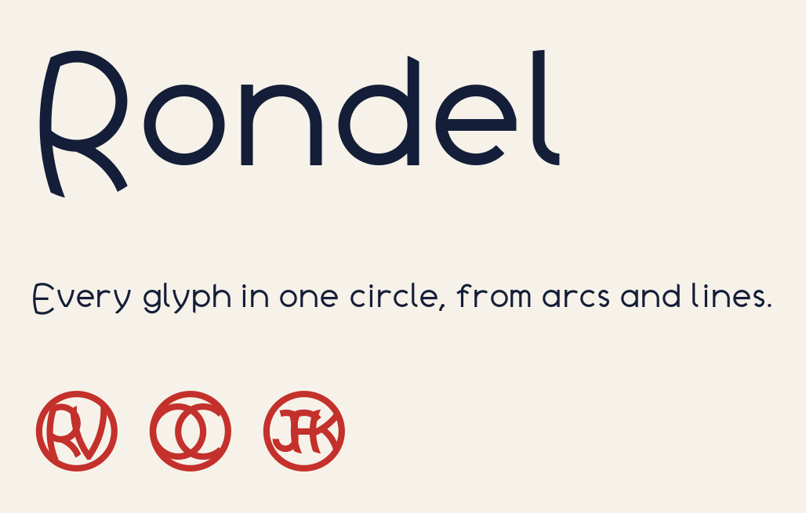
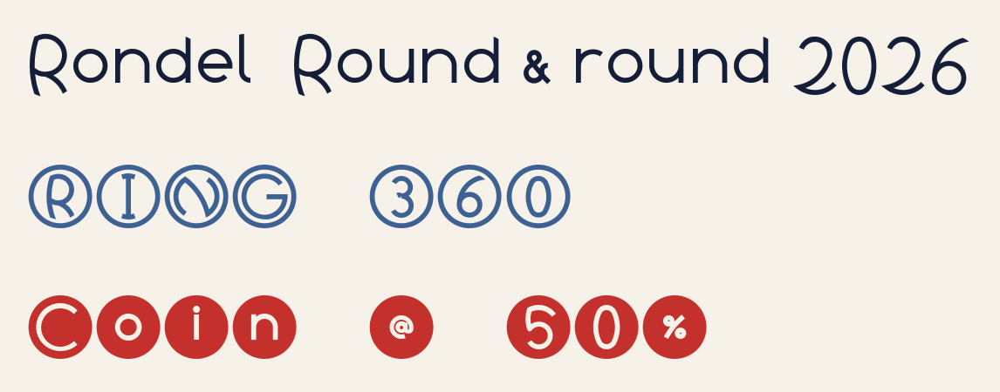
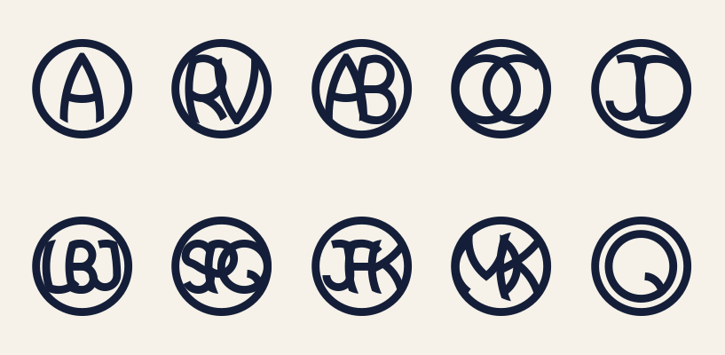
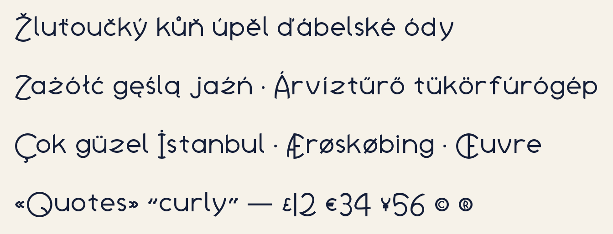
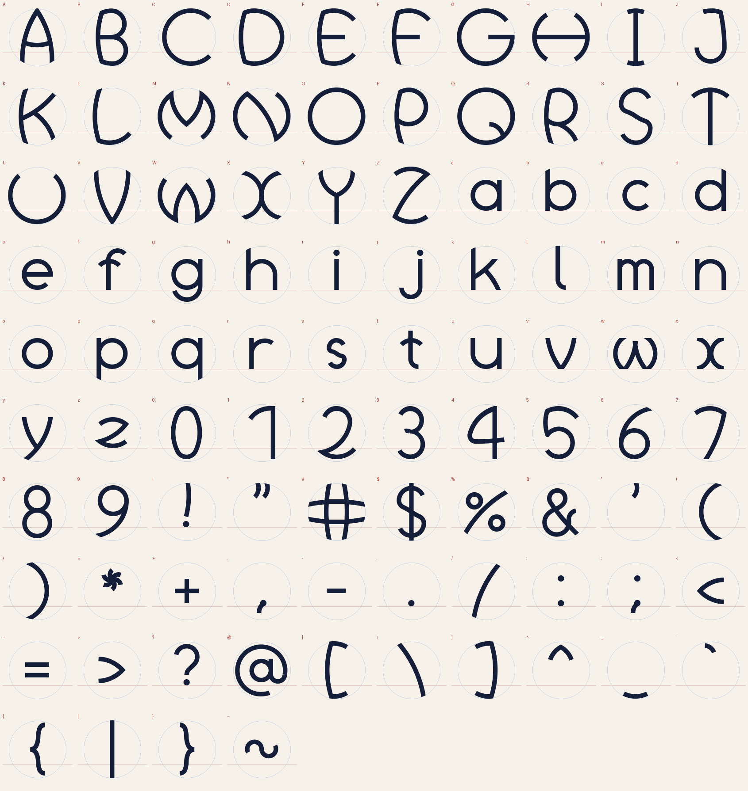

# Rondel



Rondel is a display typeface in which every letter, figure and symbol is drawn inside the same circle, using only arcs of circles and straight lines. Strokes that reach the edge are trimmed by that circle, so their ends are curved cuts lying on it.

**[See the specimen](https://q78717.github.io/font-rondel/)** · **[Download the fonts](https://github.com/q78717/font-rondel/releases/latest)**

## Styles

| Style | What it is | Spacing |
| --- | --- | --- |
| **Rondel** | Open letters; the circle is implied by the cuts | Proportional, kerned |
| **Rondel Ring** | Each glyph inside a visible ring | Monospaced |
| **Rondel Coin** | Each glyph cut out of a solid disc | Monospaced |



## Monograms

Type one to three letters between `<` and `>` and Rondel sets them as a single medallion: `<RV>`, `<JFK>`, `<Q>`. Lowercase works too.



Each initial gets its own circle. All the circles in a monogram have the same radius and overlap inside the ring: two letters form a vesica piscis, three form a chain where each circle passes through its neighbour's centre. Strokes that reach the ring fuse into it.

- Works in **Rondel** and **Rondel Ring**. Coin has no monograms.
- Uses the font's contextual alternates and standard ligatures. These are on by default in browsers, Figma and Adobe apps. In Microsoft Word, turn on Contextual Alternates or Standard Ligatures under Font › Advanced.
- Four or more letters, spaces, or anything other than A–Z are left as plain text, so `a < b` is unaffected.

## Character set

Google Fonts' Latin Core set: the Latin languages of Western, Central and Eastern Europe, with curly quotes, dashes, currency signs and combining accents. Accents are drawn from arcs and lines too. On lowercase they sit inside the circle; capitals already fill their circle, so their accents sit just outside it.



Rondel is a display face: it reads best at 32 px and up, and monograms at 48 px and up. It isn't intended for body text or interface labels.



## Using the fonts

**Desktop:** download the latest release and install the `.ttf` files.

**Web:** use the `.woff2` files.

```css
@font-face {
  font-family: "Rondel";
  src: url("Rondel-Regular.woff2") format("woff2");
  font-display: swap;
}
```

## Building from source

Every glyph is a short Python function in `sources/build_rondel.py` that draws arcs and lines. The script strokes and merges them and writes the UFO sources in `sources/ufo/`; [gftools builder](https://github.com/googlefonts/gftools) then compiles and hints the fonts. The repository follows the [Google Fonts project template](https://github.com/googlefonts/googlefonts-project-template). Requires Python 3.13.

```sh
make build    # sets up venv/ from requirements.txt, then runs sources/build.sh
make test     # checks the fonts with fontspector (cargo binstall fontspector)
make proof    # HTML proofs in out/proof (cargo binstall diffenator3)
make images   # redraws the PNG images in documentation/images
```

`sources/build.sh` is the single build command: it writes `sources/ufo/`, compiles every `sources/config*.yaml` into `fonts/ttf/` and `fonts/webfonts/`, rebuilds `documentation/specimen/index.html`, and checks that monograms still work.

Dependencies are listed in `requirements.in`; `make update` regenerates the pinned `requirements.txt`. To check with FontBakery instead of fontspector, use a separate environment: `pip install -r requirements-qa.txt`.

## Licence

Copyright 2026 The Rondel Project Authors. Rondel is licensed under the [SIL Open Font License 1.1](OFL.txt): free to use, modify and redistribute, including commercially, but the fonts may not be sold on their own.
